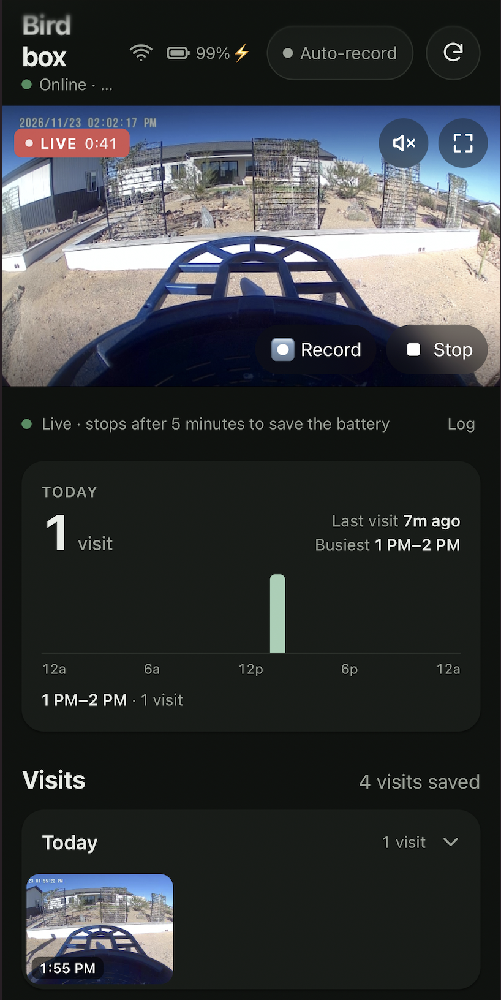

# Bird feeder viewer

A local web viewer for a VicoHome-based feeder camera (VEVOR FB-A01 / "Q8").
It polls the unofficial VicoHome cloud API for motion events, saves each
snapshot and clip to `data/media/` before the cloud links expire, and serves a
gallery at http://localhost:8080.

  

**Live view** (experimental): opening the page starts a muted live stream from
the camera over WebRTC through VicoHome's cloud, the same way the app does. The
camera exposes no local ports, so there is no local stream. Live view wakes the
camera and uses battery, so it pauses in the background and stops on its own
after 5 minutes. Safari is the best bet if the camera only sends H.265.

**Clips without a cloud plan**: without a VicoHome plan the cloud only keeps
a snapshot per visit. Two free ways to get video, both saved next to the
snapshot in `data/media/`:

- **From the camera's microSD card** (best): with a card in the feeder, the
  camera records every visit itself from the motion trigger. Opening a visit
  downloads that recording over the live connection and plays it in the
  viewer when it arrives, and **Auto-record** does it for each new visit
  about 30 s after it happens.
  (Experimental: protocol from ha-vicohome-bridge, not yet confirmed on this
  feeder.)
- **From live view**: without a card, Auto-record opens live view for each new
  visit and records 20 s (`RECORD_SECONDS`). These start when the viewer
  notices the visit (within about 30 s plus camera wake-up). The **⏺ Record**
  button in the live player records by hand.

Auto-record runs in the browser, so keep the page open (Safari on a Mac that
doesn't sleep works best; an iPhone pauses the page when locked). Each fetch
wakes the camera and briefly signs the VicoHome phone app out.

## Setup

1. Copy `.env.example` to `.env` (`cp .env.example .env && chmod 600 .env`) and
   fill in your VicoHome login (ideally a second account that the
   feeder is shared with, since VicoHome allows one session per account).
2. `python3 server.py --probe` checks the login and prints what the API returns.
3. `python3 server.py`, then open http://localhost:8080.

Requires Python 3.8+ and, to save clips, ffmpeg (`brew install ffmpeg`).

API endpoints from https://github.com/TomTje/vicohome-ha (MIT) and from the
VicoHome iOS app's own traffic; the live-view signalling flow follows
https://github.com/bbielsa/vicostream. SD-card download, the signalling fixes
and the cloud-clip completeness rules follow
https://github.com/jbuck2005/ha-vicohome-bridge (MIT), which builds on
https://github.com/averagenative/vicolocal (MIT); see also
https://github.com/maxeo/ha-vicohome (MIT). No code from these projects is
copied; their findings are re-implemented here. The API is undocumented and may
change or stop working.
